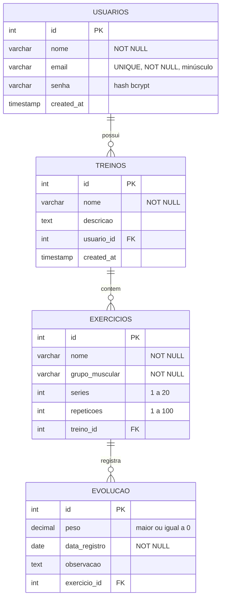

# 🏋️ GymTracker

Aplicação web para **organizar treinos de academia, cadastrar exercícios e acompanhar a evolução das cargas** ao longo do tempo.

Projeto acadêmico composto por **API própria (Node.js + Express)**, **banco relacional (PostgreSQL)** e **front-end web (HTML, CSS e JavaScript)**.

---

## Sumário

1. [Problema e solução](#1-problema-e-solução)
2. [Tecnologias](#2-tecnologias)
3. [Arquitetura e organização](#3-arquitetura-e-organização)
4. [Banco de dados](#4-banco-de-dados)
5. [Endpoints da API](#5-endpoints-da-api)
6. [Autenticação e autorização](#6-autenticação-e-autorização)
7. [Segurança](#7-segurança)
8. [Integrações externas](#8-integrações-externas)
9. [Testes automatizados](#9-testes-automatizados)
10. [Instalação e execução](#10-instalação-e-execução)
11. [Uso de Inteligência Artificial](#11-uso-de-inteligência-artificial)

---

## 1. Problema e solução

**Problema:** quem treina costuma anotar a ficha em papel ou no bloco de notas do celular. Fica difícil saber quais exercícios fazem parte de cada treino e, principalmente, **se a carga está aumentando** de uma semana para a outra.

**Solução:** o GymTracker permite que cada usuário, com sua própria conta:

- crie **treinos** (ex.: "Treino A – Peito e Tríceps");
- cadastre **exercícios** dentro de cada treino, com grupo muscular, séries e repetições;
- registre a **carga usada** em cada exercício por data;
- veja automaticamente **quanto a carga subiu ou caiu** em relação ao registro anterior (▲ +2,5 kg);
- acompanhe um resumo com o total de treinos, exercícios e registros.

Todas as operações de cadastro, consulta, alteração e exclusão são feitas por **modais** na interface, com validação e confirmação antes de excluir.

---

## 2. Tecnologias

| Camada | Tecnologia |
|---|---|
| API | Node.js, Express 5 |
| Banco de dados | PostgreSQL + driver `pg` |
| Autenticação | JSON Web Token (`jsonwebtoken`) |
| Senhas | `bcrypt` (hash com salt, custo 10) |
| Configuração | `dotenv` (arquivo `.env`) |
| Documentação da API | Swagger UI (`swagger-ui-express`) + OpenAPI 3 |
| Testes | Jest + Supertest |
| Front-end | HTML5, CSS3 e JavaScript puro (Fetch API) |

---

## 3. Arquitetura e organização

```
Gymtracker/
├── back-end/
│   ├── app.js                 # monta o Express: middlewares, rotas, Swagger, erros
│   ├── server.js              # sobe o servidor (separado do app para os testes)
│   ├── config/db.js           # conexão com o PostgreSQL (Pool)
│   ├── middleware/
│   │   ├── auth.js            # valida o JWT e gera tokens
│   │   └── erros.js           # 404 e tratamento global de erros
│   ├── utils/validacoes.js    # regras de negócio / validações (funções puras)
│   ├── routes/                # um arquivo por recurso
│   │   ├── usuarios.js        # cadastro
│   │   ├── login.js           # login
│   │   ├── perfil.js          # ver, editar e excluir a conta
│   │   ├── treinos.js         # CRUD de treinos
│   │   ├── exercicios.js      # CRUD de exercícios
│   │   ├── evolucao.js        # CRUD de registros de carga
│   │   └── stats.js           # contadores do usuário
│   ├── docs/openapi.json      # documentação Swagger
│   ├── tests/                 # testes automatizados
│   ├── .env.example
│   └── package.json
├── database/
│   └── schema.sql             # script de criação do banco
├── front-end/
│   ├── css/base.css           # visual comum das páginas internas
│   ├── css/ui.css             # modais, avisos (toast) e carregamento
│   ├── js/api.js              # fetch com token, sessão, escape de HTML
│   ├── js/ui.js               # componente de modal e toast
│   └── *.html                 # páginas
└── README.md
```

**Fluxo de uma requisição:**

```
Front-end (fetch + token)  →  Express  →  middleware autenticar (JWT)
   →  rota  →  validações (utils)  →  consulta parametrizada (pg)  →  PostgreSQL
   ←  JSON + código HTTP adequado (200, 201, 400, 401, 403, 404, 409, 500)
```

O front-end **nunca acessa o banco**: ele só conversa com a API.

---

## 4. Banco de dados

### Modelo conceitual

- Um **usuário** possui vários **treinos**.
- Um **treino** possui vários **exercícios**.
- Um **exercício** possui vários **registros de evolução** (carga por data).

### Modelo lógico



**Restrições de integridade:** chaves primárias `SERIAL`, chaves estrangeiras com `ON DELETE CASCADE` (excluir um treino apaga seus exercícios e registros), `UNIQUE` no email, `NOT NULL` nos campos obrigatórios e `CHECK` em séries, repetições, peso, nome e formato do email. Há índices nas chaves estrangeiras.

O script completo está em [`database/schema.sql`](database/schema.sql).

---

## 5. Endpoints da API

Documentação interativa (Swagger): **http://localhost:3000/api-docs**

🔒 = precisa do header `Authorization: Bearer <token>`

| Método | Rota | Descrição |
|---|---|---|
| POST | `/usuarios` | Cadastrar usuário |
| POST | `/login` | Login, devolve o token JWT |
| GET 🔒 | `/perfil` | Dados do usuário logado |
| PUT 🔒 | `/perfil` | Editar nome/email e, opcionalmente, trocar a senha |
| DELETE 🔒 | `/perfil` | Excluir a conta (pede a senha) |
| GET 🔒 | `/stats` | Total de treinos, exercícios e registros |
| GET 🔒 | `/treinos` | Listar meus treinos (com total de exercícios) |
| GET 🔒 | `/treinos/:id` | Buscar um treino |
| POST 🔒 | `/treinos` | Criar treino |
| PUT 🔒 | `/treinos/:id` | Editar treino |
| DELETE 🔒 | `/treinos/:id` | Excluir treino |
| GET 🔒 | `/exercicios?treino_id=` | Listar meus exercícios (filtro opcional) |
| GET 🔒 | `/exercicios/grupos` | Grupos musculares aceitos |
| POST 🔒 | `/exercicios` | Cadastrar exercício |
| PUT 🔒 | `/exercicios/:id` | Editar exercício |
| DELETE 🔒 | `/exercicios/:id` | Excluir exercício |
| GET 🔒 | `/evolucao?exercicio_id=` | Listar registros com a variação de carga |
| POST 🔒 | `/evolucao` | Registrar carga |
| PUT 🔒 | `/evolucao/:id` | Editar registro |
| DELETE 🔒 | `/evolucao/:id` | Excluir registro |

**Regras de negócio principais:**

- cada usuário só vê e altera os próprios dados (o dono vem do token, nunca do corpo da requisição);
- não é possível cadastrar exercício em treino de outra pessoa nem registrar carga em exercício de outra pessoa;
- séries de 1 a 20, repetições de 1 a 100, grupo muscular de uma lista fixa;
- carga entre 0 e 999,99 kg e data não pode estar no futuro nem ser impossível (ex.: 31/02);
- o campo `diferenca` da evolução é calculado pelo banco (`LAG`) comparando com o registro anterior do mesmo exercício;
- email é salvo em minúsculas e não pode se repetir (409).

Exemplo:

```http
POST /exercicios
Authorization: Bearer eyJhbGciOi...
Content-Type: application/json

{ "nome": "Supino reto", "grupo_muscular": "Peito", "series": 4, "repeticoes": 10, "treino_id": 1 }
```

```json
201 Created
{ "id": 7, "nome": "Supino reto", "grupo_muscular": "Peito", "series": 4, "repeticoes": 10, "treino_id": 1 }
```

---

## 6. Autenticação e autorização

1. **Cadastro** (`POST /usuarios`): a senha é transformada em hash com `bcrypt` antes de ir para o banco. A senha em texto puro nunca é salva.
2. **Login** (`POST /login`): o `bcrypt.compare` confere a senha com o hash. Se estiver certa, a API gera um **JWT** assinado com `JWT_SECRET` (vale 8 horas), contendo `id`, `nome` e `email`.
3. O front-end guarda o token no `localStorage` e o envia em toda requisição no header `Authorization: Bearer <token>` (arquivo `front-end/js/api.js`).
4. O middleware `autenticar` (`back-end/middleware/auth.js`) verifica o token em todas as rotas protegidas. Sem token ou com token inválido/expirado → **401**.
5. **Autorização:** todas as consultas filtram pelo `req.usuario.id` vindo do token. Tentar acessar o treino, exercício ou registro de outro usuário devolve **404** (não revela que o recurso existe).
6. Se a API responder 401, o front-end apaga a sessão e volta para o login. Páginas internas redirecionam para o login quando não há token.

---

## 7. Segurança

| Requisito | Como foi atendido |
|---|---|
| SQL Injection | Todas as consultas usam parâmetros (`$1`, `$2`...) do `pg`. Nenhum dado do usuário é concatenado no SQL. |
| Validação | `utils/validacoes.js` na API + validação dos formulários no front (required, min, max). |
| Tratamento de exceções | `try/catch` em todas as rotas, middleware global de erros, JSON inválido → 400, rota inexistente → 404. Mensagens internas do banco não vão para o cliente. |
| Senhas | Hash `bcrypt`. Trocar a senha ou excluir a conta exige a senha atual. |
| Credenciais | `.env` fora do repositório (`.gitignore`), modelo em `.env.example`. |
| XSS no front | Tudo que o usuário digita passa por `escaparHTML()` antes de ir para a tela. |
| Separação de responsabilidades | rotas / middlewares / validações / configuração / front separados. |

---

## 8. Integrações externas

O projeto **não consome APIs externas** nesta versão (o enunciado deixa isso como opcional). A integração com serviços como IA para sugerir treinos fica como melhoria futura e, se for feita, deve passar pela API do grupo, nunca direto pelo front-end.

---

## 9. Testes automatizados

```bash
cd back-end
npm test
```

São **47 testes** em dois arquivos:

- **`tests/validacoes.test.js`** — testes unitários das regras de negócio: IDs, email, tamanho da senha, campos obrigatórios, limites de séries/repetições, grupo muscular, peso negativo, data impossível, data no futuro.
- **`tests/api.test.js`** — testes das rotas com Supertest. O banco é substituído por um *mock* (`jest.mock`), então os testes rodam sem PostgreSQL. Cobrem:
  - cadastro com senha salva como hash e email normalizado; email repetido (409); senha curta (400);
  - login certo (token), senha errada e email inexistente (401);
  - rotas sem token ou com token falso (401), JSON mal formatado (400), rota inexistente (404);
  - CRUD de treinos usando o id do token e ignorando `usuario_id` enviado no corpo;
  - acesso a recursos de outro usuário (404);
  - erro no banco devolvendo 500 sem expor detalhes.

---

## 10. Instalação e execução

### Pré-requisitos

- [Node.js](https://nodejs.org) 18 ou superior
- [PostgreSQL](https://www.postgresql.org) 13 ou superior

### Passo a passo

**1. Clonar o projeto**

```bash
git clone https://github.com/HrSsales/Gymtracker.git
cd Gymtracker
```

**2. Criar o banco**

```bash
psql -U postgres -c "CREATE DATABASE gymtracker;"
psql -U postgres -d gymtracker -f database/schema.sql
```

(ou abra o `schema.sql` no pgAdmin e execute no banco `gymtracker`)

**3. Configurar a API**

```bash
cd back-end
npm install
cp .env.example .env      # no Windows: copy .env.example .env
```

Abra o `.env` e preencha a senha do seu PostgreSQL e um `JWT_SECRET` qualquer, longo. Para gerar um:

```bash
node -e "console.log(require('crypto').randomBytes(48).toString('hex'))"
```

**4. Rodar**

```bash
npm start        # ou: npm run dev (reinicia sozinho ao salvar)
```

**5. Usar**

- Site: **http://localhost:3000** (a própria API serve o front-end)
- Documentação da API: **http://localhost:3000/api-docs**

> Também dá para abrir as páginas com o Live Server do VS Code; elas chamam a API em `http://localhost:3000`.

**6. Testes**

```bash
npm test
```

---

## 11. Uso de Inteligência Artificial

> ⚠️ **Grupo: revisem e completem esta seção com a experiência real de vocês.** O professor pede que todos saibam explicar o código, inclusive as partes feitas com IA.

**Ferramentas e modelos**

| Ferramenta | Modelo | Onde foi usada |
|---|---|---|
| Claude (Anthropic) | Claude Opus 5.5 | Revisão do projeto completo contra os requisitos, correção de bugs, autenticação JWT, modais, testes e documentação |
| _(preencher)_ | _(preencher)_ | _(outras ferramentas usadas pelo grupo, ex.: ChatGPT, Copilot)_ |

**Atividades em que a IA ajudou**

- revisão do código e comparação com os requisitos do professor;
- identificação de bugs (ex.: rota `DELETE /evolucao` declarada dentro do `POST`, contagem de evoluções usando uma coluna inexistente, página do dashboard cortada no meio);
- implementação do JWT, do middleware de autenticação e do controle de acesso por usuário;
- troca dos `prompt()`/`confirm()` do navegador por modais;
- escrita dos testes automatizados e da documentação Swagger.

**Erros e limitações encontrados nas respostas da IA**

- _(preencher com o que o grupo percebeu — ex.: sugestões que não rodaram de primeira, trechos que precisaram ser ajustados ao estilo do projeto, partes que o grupo decidiu não usar)_

**Correções e adaptações feitas pelo grupo**

- _(preencher)_

**Principais dificuldades**

- _(preencher)_

**Avaliação**

- _(preencher: em poucas linhas, como a IA ajudou e onde o grupo precisou entender e decidir por conta própria)_
